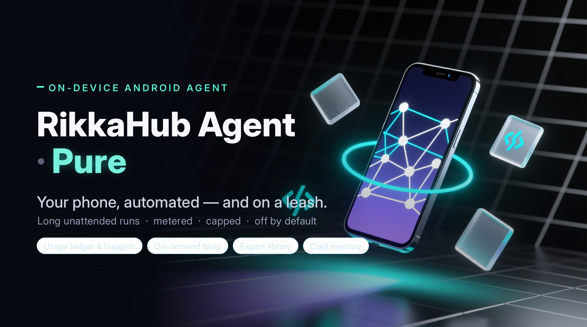

<div align="center">



<br/>

<p>
  <a href="https://github.com/wuyhong715/rikkahub-agent-pure/actions/workflows/build.yml"></a>
  
  
  
  
</p>

**RikkaHub Agent · Pure** is an independent, hardened continuation of the on-device Android agent from [ExTV/rikkahub-agent](https://github.com/ExTV/rikkahub-agent) (itself built on [RikkaHub](https://github.com/rikkahub/rikkahub)). It keeps the *entire* upstream surface and adds one layer that answers a single question:

> **Can this run for hours without blowing up the context — or the bill?**

<a href="#why-this-project">Why this project</a> · <a href="#the-seven-additions">What's added</a> · <a href="#what-you-can-do-with-it">What it can do</a> · <a href="#screens">Screens</a> · <a href="#getting-started">Get started</a> · <a href="#documentation">Docs</a> · <a href="#中文说明">简体中文</a>

</div>

---

## Why this project

```
rikkahub/rikkahub                     the original native Android LLM chat client
   └─ ExTV/rikkahub-agent             adds the agent layer: device tools, workflows,
        │                             shells (Shizuku/Termux), sub-agents, Telegram bot…
        └─ wuyhong715/rikkahub-agent-pure    ★ this repo — the "Pure" hardening pass
```

Upstream's agent layer was built feature-first: the goal was to *add capabilities*, not to make a long unattended run survive its own output. Six things got in the way — every tool schema injected every turn; compaction that only fires on a token threshold; one `logcat` dump able to flood the context; sub-agents receiving only a bare `task` string; tokens counted but never attributed; and headless paths (cron, workflows) that auto-approved everything.

Pure removes nothing. It keeps the whole upstream surface and makes a long run **survivable, observable and capped**.

> **Note** — since 2026-10-07 this repository is **standalone**: it is no longer a GitHub fork and no longer auto-syncs from upstream.

## The seven additions

Every one of these is **off by default** — with the switch off, the default path is unchanged (several are byte-for-byte identical to upstream).

| | Addition | What it gives you |
|---|---|---|
| 💰 | **Usage ledger & budgets** | Every model call metered by purpose and cost; an orchestration can be capped. |
| 🧰 | **On-demand tools** | Search a tool directory; load only the schemas the model actually opens. |
| 🛡 | **Long-run survival** | Tool-result budgets, model-initiated compaction, execution retry, keep-alive. |
| 👥 | **Expert library** | Reusable sub-agents, each with its own model, tools, namespace and memory. |
| 📚 | **Cold memory** | A Markdown knowledge base read on demand, instead of pinned in context. |
| 🔗 | **Workflows that chain** | Data flow between actions, plus an encrypted secret store. |
| 🔒 | **Headless safety fixes** | Closed the paths where background runs auto-approved everything. |

Full detail — what each one does, the exact tool names, and where every switch lives — is in **[docs/PURE-FEATURES.md](docs/PURE-FEATURES.md)**.

## What you can do with it

**See where the money goes.** *"How much did sub-agents cost me this week?"* — the Statistics page groups the ledger by day / purpose / model / assistant and shows tok/s, and the orchestration tree lays out every parent → child dispatch. Cost is frozen at write time, so history doesn't shift when a provider changes its rates.

**Cap a run.** Set an orchestration token budget on an assistant — it covers the parent turn *and* everything it fans out. A dispatch that would exceed it is refused **before** it starts, with a readable reason the model can act on. Each expert can carry its own ceiling.

**Run a long job unattended.** *"Refactor this module, run the tests, and keep going until they pass."* A tool result that would flood the context is capped and spilled to disk with head + tail kept; the model can compress the conversation on its own; and the run holds a foreground service so switching apps doesn't kill it.

**Build a team.** *"Create an expert called `researcher` that only uses web tools on the cheap model, and a `coder` that can edit files."* Then: *"dispatch the researcher to find X and the coder to implement Y, in parallel."* Experts persist with their own namespace and memory, so you name them instead of re-describing them each time.

**Keep a library.** Point cold memory at a folder of Markdown; the agent indexes it and reads only what it needs. A large knowledge base costs nothing until it's actually read.

**Wire up the boring stuff.** *"When I connect to the office WiFi, POST my status to this API."* Workflow actions can pass data to each other and pull credentials from an encrypted store, so tokens never sit in the workflow definition.

**Travel light.** Turn on the tool palette and the agent *searches* for the tool it needs, instead of carrying every schema on every turn.

## Screens

| Chat | Providers | Assistants |
|:---:|:---:|:---:|
|  |  |  |

## Getting started

### 0 · Install

Download the latest APK from **[Releases](https://github.com/wuyhong715/rikkahub-agent-pure/releases/latest)** — or build from source (below).

It is a **signed, R8-optimized build** (`com.myagent.app`): it installs **side by side** with a release build of the upstream app.

### 1 · Add a model provider

**Settings → Providers → pick one → paste your API key.**

- **OpenRouter** — first-class support (auto-detected capabilities, pricing, routing, fallback models)
- **Codex / Grok** — sign in with your OpenAI / xAI account (OAuth, no key)
- **Local · LiteRT** — download a model (Gemma, Qwen) and run it on-device, no network
- **AICore** — Gemini Nano on Pixel 8/9/10 (AICore Beta)
- …or any OpenAI-compatible endpoint

### 2 · Turn on the tools you want

**Settings → Assistant → tap your assistant → Local Tools** — flip the groups you want. If you turn nothing on, the app behaves exactly like vanilla RikkaHub.

Inside an enabled group you can now switch **individual tools** off, not just the whole group. And **Settings → Sub-agent profiles → Tool palette** lets you search the whole tool directory (57 groups, ~180 tools) to find where a tool lives before enabling it.

### 3 · Your first conversation

1. Leave Settings and open a **new chat**.
2. Ask something that uses a tool: *"What's my battery level?"* — approve the tool call when it asks.
3. Tap the tool call in the reply to inspect the result and re-run it with the same arguments, without spending a new turn.
4. Try a multi-step one: *"Find the PDFs on my phone and summarise the one about invoices."*
5. Open the chat **drawer → Statistics** to watch the tokens land in the ledger.

That's the upstream experience. Everything below is the Pure layer — all optional.

### 4 · Turn on the Pure features

**A. Budgets and the ledger** — Assistant → **Basic Settings**: *Tool result budget*, *Orchestration token budget*, *Concurrent sub-agents*. Then: chat drawer → **Statistics** for the ledger and orchestration tree. Price table: Settings → **Providers** → *model* → **Price** tab.

**B. The advanced switches** — Assistant → **Basic Settings** → **Advanced / experimental** card (off by default, read the risk note):
- *Model-initiated context compaction* (`compact_context`)
- *Tool surface mode* (`tool_search` / `tool_open`)
- *Sub-agent context references*
- *Freeze sub-agent tool surface*

**C. Experts** — Settings → **Sub-agent profiles**: create an expert with its own prompt, model, tool surface, MCP servers, skills and namespace. Then just dispatch to it by name.

**D. Cold memory** — bind a workspace (Assistant → Basic Settings), then Assistant → **Memory** → *Cold memory (Markdown)* and pick a folder.

**E. Workflow secrets** — Settings → **Workflows** → open one → **API secrets**; reference them from a `web_fetch` header as `{{secret:NAME}}`.

### Cheat sheet · where things live

| I want to… | Go to |
|---|---|
| Enable/disable tools (per group or per tool) | Settings → Assistant → *assistant* → **Local Tools** |
| Search the tool directory | Settings → **Sub-agent profiles** → **Tool palette** |
| Set budgets / tool-result cap | Settings → Assistant → *assistant* → **Basic Settings** |
| Experimental switches | Assistant → **Basic Settings** → **Advanced / experimental** |
| Manage reusable experts | Settings → **Sub-agent profiles** |
| Cold memory folder | Assistant → **Memory** → **Cold memory (Markdown)** |
| See spend, tok/s, orchestration tree | Chat drawer → **Statistics** |
| Edit model prices | Settings → **Providers** → *model* → **Price** |
| Workflow API secrets | Settings → **Workflows** → *workflow* → **API secrets** |

## Requirements

| | |
|---|---|
| **Device** | Android 8.0+ (API 26), arm64 or x86_64, ~51 MB |
| **Provider** | OpenAI, Google, Anthropic, OpenRouter, Codex, Grok, Ollama, any OpenAI-compatible endpoint — or an on-device LiteRT / AICore model |

## Build from source

Requires **JDK 17**, the Android SDK (`platform-tools`), and **[bun](https://bun.sh)** + **[pnpm](https://pnpm.io)** on your `PATH` (bun installs the web-ui dependencies, pnpm builds the bundle).

```bash
git clone --recursive https://github.com/wuyhong715/rikkahub-agent-pure.git
cd rikkahub-agent-pure

./gradlew :app:assembleDebug      # -> app/build/outputs/apk/debug/*.apk
./gradlew :app:assemblePure       # -> app/build/outputs/apk/pure/*.apk (R8-optimized, unsigned)
./gradlew :app:testDebugUnitTest  # unit tests
```

| | |
|---|---|
| **Package** | `excp.rikkahub` (debug: `excp.rikkahub.debug`) |
| **Version** | 2.5.3-pure.6 (versionCode 202) |
| **Stack** | Kotlin · Jetpack Compose · Room |
| **Tests** | 2,290+ unit tests, green in CI |

## Documentation

| Doc | What's in it |
|---|---|
| [docs/PURE-FEATURES.md](docs/PURE-FEATURES.md) | **What Pure adds** — every addition, its tools and switches, and where to find them. 中文对照在文末 |
| [docs/PURE-DESIGN.md](docs/PURE-DESIGN.md) | **Design notes** — why a separate project, the rules it holds to, the three execution strengths, non-goals |
| [docs/engineering/PHASE2.md](docs/engineering/PHASE2.md) | Engineering log, per change (中文) |
| [docs/engineering/ACCEPT-FIX.md](docs/engineering/ACCEPT-FIX.md) | Acceptance-fix batch record (中文) |
| [docs/engineering/QA-PHASE2.md](docs/engineering/QA-PHASE2.md) | On-device QA findings (中文) |
| [upstream README](https://github.com/ExTV/rikkahub-agent#features) | The full upstream feature tour this project builds on |

## Community

- **QQ group**: `1030362371` — install help, usage questions and feature requests (Chinese).
- **Issues**: [open one](https://github.com/wuyhong715/rikkahub-agent-pure/issues) for bugs and feature requests.

## Credits

| Project | Role |
|---|---|
| [RikkaHub](https://github.com/rikkahub/rikkahub) | The upstream chat client this project is built on |
| [ExTV/rikkahub-agent](https://github.com/ExTV/rikkahub-agent) | The direct upstream — the agent layer this builds on |
| [cron-utils](https://github.com/jmrozanec/cron-utils) | Cron parser for the scheduler |
| [whisper.cpp](https://github.com/ggerganov/whisper.cpp) | On-device speech-to-text via Termux |
| [Termux](https://github.com/termux/termux-app) | Shell + package manager |
| [JSch (mwiede fork)](https://github.com/mwiede/jsch) | Native SSH client |
| [FlorisBoard](https://github.com/florisboard/florisboard) | Base for the companion [agent-keyboard](https://github.com/ExTV/agent-keyboard) |

This project is unaffiliated with the upstream RikkaHub or ExTV maintainers. All credit for the underlying chat client, provider abstraction and UI design goes to them.

## License

GNU AGPL-3.0, inherited from upstream. See [LICENSE](LICENSE).

---

## 中文说明


**RikkaHub Agent · Pure** —— [ExTV/rikkahub-agent](https://github.com/ExTV/rikkahub-agent)（其上游为 [rikkahub/rikkahub](https://github.com/rikkahub/rikkahub)）的**独立强化延续**（2026-10-07 起已脱离 fork 网络），**面向长时间无人值守的 agent 运行**。它完整保留上游功能，只加一层，回答一个问题：*能不能跑几个小时，而不炸上下文、不炸钱包？*

### 为什么做这个项目

上游的 agent 层是"功能优先"建起来的——目标是**加能力**，而不是让一次长跑能扛住自己的输出。六个拦路虎：每轮都注入所有已启用工具的 schema；压缩只在 token 阈值上触发；一个 `logcat` 转储就能灌爆上下文；子 agent 只拿到一个光秃秃的 `task` 字符串；token 有计数却从不归属；无头路径（cron、工作流）会自动批准一切。

Pure 不删任何功能，只让长跑变得**可存活、可观察、可封顶**。

> **说明**：自 2026-10-07 起本仓库已脱离 fork 网络、成为独立仓库，不再自动同步上游。

### 多了什么（全部默认关）

| | 新增 | 一句话 |
|---|---|---|
| 💰 | **用量账本与预算** | 每次调用按用途与成本记账；编排可设上限 |
| 🧰 | **按需工具** | 可搜索工具目录；只注入模型真正打开的 schema |
| 🛡 | **长任务存活** | 工具结果预算、模型主动压缩、执行级重试、保活 |
| 👥 | **专家库** | 可复用子 agent，各有模型/工具/命名空间/记忆 |
| 📚 | **冷记忆** | Markdown 知识库，按需读取而非常驻 |
| 🔗 | **可串接的工作流** | 动作间传值 + 加密密钥库 |
| 🔒 | **无头安全修复** | 堵住后台运行"全自动批准"的路径 |

逐项细节、**确切的工具名与开关名**、以及它们各自在哪个菜单：见 **[docs/PURE-FEATURES.md](docs/PURE-FEATURES.md)**（文末有中文对照）。

### 能做到什么

- **看清钱花在哪**：Statistics 页按 日/用途/模型/助手 分组，带 tok/s，编排树列出每次父→子派发；成本在写入时冻结，价目变动不改写历史。
- **给一次运行封顶**：助手级编排 token 上限，**派发前**检查，超限直接拒派并回可读原因。
- **长任务托管**：*"重构这个模块、跑测试、跑到全绿为止"* —— 工具结果超长就留头尾、全文落盘；模型可自行压缩；后台不被杀。
- **组建团队**：*"建一个 `researcher`（只用网页工具、跑便宜模型）和一个 `coder`（能改文件）"*，之后按名字派发、并行跑。
- **养一个知识库**：冷记忆指向一个 Markdown 目录，按需索引与阅读，库再大也不占常驻上下文。
- **把杂事自动化**：*"连上公司 WiFi 就往这个 API POST 状态"* —— 动作间可传值，密钥存加密库。
- **轻装出行**：打开工具调色板，让 agent 去"搜"它需要的工具，而不是每轮背着所有 schema。

### 开始用（第一次对话）

0. **安装**：从 **[Releases](https://github.com/wuyhong715/rikkahub-agent-pure/releases/latest)** 下载最新 APK（或从源码构建）。它是**已签名、经 R8 优化**的构建（`excp.rikkahub.debug`），可与上游 release **并存**安装。
1. **接模型**：设置 → 模型提供商 → 选一个 → 填 API key（或 Codex/Grok OAuth、本地 LiteRT、Pixel 的 AICore）。
2. **开工具**：设置 → 助理 → 点你的助手 → **本地工具** → 打开你要的组（组内还能**逐工具**关闭）。什么都不开＝原版 RikkaHub。
3. **第一次对话**：回到聊天，新建会话 → 问一句要用工具的，如 *"我的电量多少？"* → 弹审批就允许 → 点回复里的工具调用可查看结果、用同参数重跑。再试 *"找出手机里的 PDF，把关于发票的那份总结一下"*。
4. **打开 Pure 功能**（都可选）：
   - 预算/结果上限：助理 → **基本设置**（工具结果预算 / 编排 token 预算 / 并发子 agent）
   - 实验开关：助理 → **基本设置** → **高级 / 实验功能**（模型主动压缩、工具面模式、子 agent 上下文引用、工具面冻结）
   - 专家库 + 工具调色板：设置 → **子 agent 配置**
   - 冷记忆：助理 → **记忆** → 冷记忆（Markdown）——先在基本设置里绑一个工作区
   - 工作流密钥：设置 → 工作流 → 打开一个 → **API secrets**
   - 看账单：聊天抽屉 → **统计**

### Web 端管理 SSH 主机（WebSocket）

设置 → **Web 服务器** 启动后，网页版侧栏底部的 **服务器图标** 打开「SSH 主机」面板。它走
`/api/ssh/hosts/ws`（Ktor WebSocket），与设置页共用一个数据源和同一套探测实现：

| op | 作用 |
|---|---|
| `list` / `get` | 读主机清单（只含 `hasPassword`/`hasPrivateKey` 布尔，**从不回传密钥**） |
| `save` | 新增/编辑；`secret` 留空＝沿用已存凭据；`originalName` 区分改名与重名 |
| `delete` | 删除 |
| `test` | 真实 JSch 握手（与设置页「测试连接」同一条代码路径）。答案从独立协程回来，不阻塞同一连接上的其它请求；每连接最多 4 个并发，整个进程再加一道 8 个的闸门（超了直接回 `busy`，不会排起几十条 30s 的拨号） |
| `known_hosts` / `forget_host_key` | 查看 / 忘记已信任的主机密钥 |
| `ping` | 心跳，服务端直接回 `ok`（不碰后端），用于识别半开连接 |

每个请求按 `id` 只回一帧。`id` 不透明，数字也会被当成文本回显（写成 `{"id":7}` 不会整帧
被判 `bad_request` 后让客户端干等到超时；连解析都失败的帧也会尽力把 `id` 抠出来一起回）。
`test` 是唯一晚回的：结果帧带同一个 `id` 和 `test` 字段，客户端据此与普通响应同样匹配。
改动广播给**其它**连接（发起者已拿到响应，不重复刷新）：`save`/`delete` 发
`hosts_changed`，`forget_host_key` 发 `known_hosts_changed`。广播与回帧都有发送超时：
一个不再读数据的对端不会把整个连接（连同它的协程和注册项）永久挂住。

`save` 的凭据规则：**一行只存当前所选方式的凭据**。切到密码就清掉旧私钥——否则握手会先试
publickey，把用户刚填的密码架空；旧的私钥如果已经坏了（通常正是切换的原因），测试会失败但
密码其实是对的。`webTerminalUrl` 只接受 `http://` / `https://`（它会交给内置 WebView 打开）。
鉴权沿用 `/api` 的 JWT：开启访问密码后，socket 握手必须带 `?access_token=<token>`。
客户端每 20s 发一次 `ping`，连续两次无响应即判定连接已断并重连（指数退避，最多 6 次，
之后由面板的「重新连接」按钮手动恢复）。重连期间发出的请求**排在队列里等握手完成**（共用
同一个 20s 预算），不会在 1 秒的抖动里直接报「未连接」；只有手动关掉或退避用尽才立即失败。
「忘记主机密钥」按行过滤 `known_hosts`（注释与无法解析的行原样保留），先写临时文件再原子
改名，不会把信任库写坏；网页端和设置页都会先弹确认。

### SSH 终端（抽屉 →「SSH 窗口」）

聊天输入框的 **+** 抽屉最后一项是「SSH 窗口」，打开多标签终端：已有标签原样恢复，没有
标签时显示「新建终端」并从已保存主机里挑一台。

- **颜色与样式**：SGR（16 色 / 256 色 / truecolor 前景背景、粗体、斜体、下划线、删除线、
  暗色、反显）按字符保存并渲染，`ls --color`、`git log`、Powerlevel10k 之类提示符都是原色。
  转写的落盘形态仍是「一行一个字符串」，颜色以 SGR 编码在字符串里，所以旧快照照常读、
  新快照重开应用后颜色还在。
- **尺寸**：PTY 的列数/行数按屏幕宽度推算（约 47 列），不再是桌面的 100×40——否则每行都会
  被软换行，shell 的光标位置与屏幕上的位置对不上。
- **通道模式（标签 ⋮ →「通道设置」的选择栏）**：两个模式只差一件事——进程活在哪。
  - **普通**：每次连接开一个新的登录 shell，进程就活在这条 TCP 里。链路断开（换网、掉线、
    App 被杀）后远端进程随之结束，重连得到一个新 shell；本机转写照旧保留。
  - **持久**：连接后自动挂到远端的 mux 会话上（按 `tmux` → `screen` → `abduco` 的顺序挑，
    会话名形如 `myagent-8f14e45fceea`，跟着标签落盘）。App 掉线、被系统杀掉、覆盖安装都只
    断传输：远端 mux server 接着跑，点「重连」`-A` 回同一个会话，正在跑的命令与历史输出都在。
    `tmux new -A -D -s <名>` 里的 `-D` 会踢掉掉线时残留的旧客户端，新连接因此拿到自己的
    行列数而不是两者的最小值——重连后 TUI 尺寸才是对的。主机一个 mux 都没有时终端里会直接
    打一行红字说明，而不是留一个连上却没反应的黑屏。切模式在下次连接时生效；新标签沿用当前
    标签的模式。**正连着时**点「断开」或关标签，远端会话会被一起结束；如果当时主机根本连不上，
    这条会话就收不走，之后可用 `tmux kill-session -t myagent-…` 手动清理。
- **通道生命周期**：离开页面、切标签都不关闭通道；**只有「断开」或标签上的 × 终止通道**。
  链路断掉时按 1s→2s→4s→8s…退避自动重连；**冷启动不拨号**，进入终端页时每个标签各拨一次，
  不用一个个点「重连」。持久模式里 detach（`Ctrl-b d`）不会把标签的自动重连关掉——会话还在
  远端，下次进页面或点「重连」就回去了。**App 这边的网络没了**（切 Wi-Fi/流量、进电梯）会让
  默认网络回调直接拆掉本地通道并显示「已断开」——不靠 TCP 自己发现，因为读线程卡在 `read()`
  里时内核可以几小时不吭声；网络回来立即自动拨回去，持久模式的进程全程都在远端 mux 里。
- **常驻命令（普通模式的另一条路）**：「通道设置」→「连接后自动执行」，例如
  `tmux new -A -s omp`。连接建立后 App 把它当用户敲的第一行发出去，进程于是活在远端 tmux 里
  而不是这条 TCP 里。持久模式不执行这一行（那里 App 自己已经在 mux 里了，再敲一次会套出第二层）。
- **全屏 TUI**：`vim` / `htop` / `top` 这类程序走备用屏幕（alt-screen）和光标寻址渲染，退出
  后回到原来的 shell 画面，备用屏的内容不会污染转写。已实现 CUP/CUU/CUD/CUF/CNL/CPL/CHA/
  VPA、ED/EL/ECH/ICH/DCH、IL/DL、SU/SD、DECSTBM、自动换行、双宽 CJK 与组合字符。
- **Ink 系 TUI（omp、Claude Code、gemini-cli）**：这几种是逐帧重绘、不用备用屏幕，专门对齐过：
  - 写满最后一列后光标算「在列外」，`CSI K` / `CSI 0J` 不会擦掉那一格——否则每条状态栏的
    右端都会被吃掉一个字符；`CSI D` 从列外后退一格落在最后一列（用 tmux 3.8 逐格校验过）。
  - 双宽字形不会跨左右边缘劈开，整字换到下一行，最后一格留空。
  - emoji 按两格算（`🗑` 这类 East-Asian 宽度为 neutral 的字符，JS 侧排版库也算两格）。
  - **bracketed paste**：程序 `CSI ?2004 h` 之后，多字符输入（剪贴板、输入法上屏、自动更正）
    整段用 `CSI 200 ~ … CSI 201 ~` 包起来，多行粘贴不会被当成逐条回车提交；单字符不过包，
    Enter 仍然照常发送。
  - **实时改尺寸**：程序只要做过光标寻址（即它是 TUI），键盘弹出导致可视区域变小时就发
    `window-change`，让远端按新行列重绘；纯 shell 不改尺寸（它不会重绘，改了只会把屏幕弄花），
    新尺寸留到下次连接。改尺寸有 250ms 防抖，键盘动画过程中的每一帧不会各发一次。
  - **Shift+Tab** 发 `CSI Z`（omp 用来切 thinking 强度），仅外接键盘可用。
- **回放测试**：真机抓下来的 omp 字节流（两段，含工具输出框、CJK、braille 转轮）在
  `OmpTuiReplayTest` 里逐格比对，金标准由 tmux 3.8 独立渲染同一份字节流生成。
  仍未实现：图形协议（sixel / kitty）、鼠标上报、DEC 字符集。

### 构建

需要 **JDK 17**、Android SDK（`platform-tools`）、`PATH` 上的 **bun** 与 **pnpm**。

```bash
git clone --recursive https://github.com/wuyhong715/rikkahub-agent-pure.git
cd rikkahub-agent-pure
./gradlew :app:assembleDebug      # 产物：app/build/outputs/apk/debug/*.apk
./gradlew :app:assemblePure       # 产物：app/build/outputs/apk/pure/*.apk（R8 优化，未签名）
./gradlew :app:testDebugUnitTest  # 单元测试
```

| | |
|---|---|
| **包名** | `excp.rikkahub`（debug：`excp.rikkahub.debug`） |
| **版本** | 2.5.3-pure.6（versionCode 202） |
| **技术栈** | Kotlin · Jetpack Compose · Room |
| **测试** | 2,290+ 单元测试，CI 全绿 |

### 上游功能

上游 ExTV 的全部能力原样保留（80+ 设备工具、Shizuku/Termux、工作流与定时、内置浏览器、免密钥网页搜索、Linux 工作区、SSH、音乐、skills、Telegram 机器人、MCP、Doctor 体检、本地模型、全套 provider）。完整清单见 **[上游 README](https://github.com/ExTV/rikkahub-agent#features)**。

### 设计思路

为什么要做这个项目、七条自我约束、三种执行强度、以及刻意不做的事：见 **[docs/PURE-DESIGN.md](docs/PURE-DESIGN.md)**。

### 社区

- **QQ 群**：`1030362371` —— 安装、使用、功能建议都在这儿。
- **反馈**：欢迎直接开 [Issue](https://github.com/wuyhong715/rikkahub-agent-pure/issues)。

### 许可

GNU AGPL-3.0（继承自上游）。见 [LICENSE](LICENSE)。
