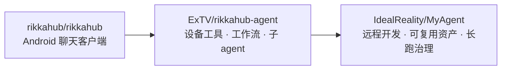

<div align="center">

<p>
  
  
  
  
</p>

**一部 Android 手机，就是一个能自己动手的 agent。**

设备工具 · SSH 终端 · 远程 LSP/DAP · 本地 skills · MCP · 长任务治理

<a href="#这是什么">这是什么</a> · <a href="#与上游的关系">谱系</a> · <a href="#多出来的是什么">多了什么</a> · <a href="#快速开始">快速开始</a> · <a href="#文档">文档</a> · <a href="#english-overview">English</a>

</div>

---

## 这是什么

MyAgent 是跑在 Android 手机**本机**上的 LLM agent：模型不只聊天——它读写文件、操作屏幕、发通知、连 SSH、调 MCP 工具、跑工作流，整台手机都是它的工具面。

本仓库是 [ExTV/rikkahub-agent](https://github.com/ExTV/rikkahub-agent)（上游为 [rikkahub/rikkahub](https://github.com/rikkahub/rikkahub)）的独立延续：这条线自 2026-10-07 起脱离 fork 网络（前身 `wuyhong715/rikkahub-agent-pure`），现在独立维护于此。改动只往一个方向走：**让 agent 在真机上连续干几小时活，而不是演示一轮**。

保留上游全部能力的前提下，这里主要补三块：

1. **远程开发** —— 手机上的 SSH 终端、远程 LSP/DAP、MCP over SSH，把"agent 只会点自己的屏幕"变成"agent 能操作你的服务器"。
2. **可复用资产** —— skills、子 agent、冷记忆、工作流密钥、JS 插件内核：能力用一次就能沉淀，不用每次重述。
3. **长任务治理** —— 用量账本与预算、按需工具面、结果预算、主动压缩、执行重试、保活。

> 上述第三块（内部代号 **Pure**）**全部默认关闭**。开关不动时，行为与上游一致。

## 与上游的关系



上游的取舍是"加能力"；这里的取舍是"让能力扛住自己的输出"——一次长跑最常死在四件事上：每轮注入所有 schema、一条 `logcat` 灌爆上下文、子 agent 只拿到一句 `task`、后台路径全自动批准。

## 多出来的是什么

### 远程开发

| 能力 | 说明 | 入口 |
|---|---|---|
| **SSH 终端** | 多标签；SGR（16 色 / 256 色 / truecolor、粗斜体下划线反显）；`vim`/`htop` 走备用屏；omp、Claude Code、gemini-cli 这类 Ink TUI 逐帧重绘专门对齐过 | 聊天 **+** 抽屉 →「SSH 窗口」 |
| **持久会话** | 连接挂到远端 `tmux` → `screen` → `abduco`；App 被杀、换网、覆盖安装都只断传输，远端进程照跑 | 标签 ⋮ →「通道设置」→ 持久 |
| **远程 LSP / DAP** | 语言服务器与调试适配器跑在远端，经 SSH 桥接回手机 | `RemoteLspTool` / `RemoteDebugTool` |
| **SFTP · 主机管理** | 密码或私钥、`known_hosts`、真实 JSch 握手测试 | 设置 → **SSH 主机** |
| **MCP over SSH** | 远端 stdio MCP 服务器直接挂上来（`ssh_stdio`），与 HTTP / OAuth 的 MCP 并存 | 设置 → MCP |
| **Web 端管理** | 启动内置 Web 服务器后，网页侧栏可管理 SSH 主机（WebSocket + JWT） | 设置 → **Web 服务器** |

协议细节、重连与半开连接判定、TUI 回放测试：见 **[docs/SSH.md](docs/SSH.md)**。

### 可复用资产

- **本地 skills** —— 随仓库分发 13 个（代回消息、哈希计算、互动地图、厨房冒险、心情记录、晨间简报、通知摘要与建议、OpenClaw 技能转换、二维码、维基查询、通知转发、3D 文字、虚拟钢琴）；支持 zip / URL 导入、隔离测试、让模型自己写。
- **子 agent（专家）** —— 各自独立的 prompt、模型、工具面、命名空间与记忆；按名字派发，可并行。
- **冷记忆** —— 一个 Markdown 目录，按需检索，不常驻上下文。
- **工作流** —— 动作之间可传值，凭据放加密 secret store，不写在定义里。
- **JS 插件内核（QuickJS）** —— 用 manifest + `main.js` 加工具，不必改 APK；内置跑团插件（`trpg_dice` 等）就是这么来的，见 [docs/TRPG.md](docs/TRPG.md)。

### 模型与多模态

| | |
|---|---|
| **Provider** | OpenAI 兼容（OpenRouter 路由、任意自建端点）、Anthropic、Google（含 Vertex）、Codex / Grok（OAuth 登录，无需 key）、AICore（Pixel）、本地模型（LiteRT / llama.cpp GGUF） |
| **生成** | `generate_image` / `edit_image`；`generate_video`（5 家厂商原生异步任务 API + 通用 `/videos`，见 [docs/VIDEO-GENERATION.md](docs/VIDEO-GENERATION.md)）；TTS / STT |
| **工具面** | 62 个工具组，可按组也可按**单个工具**关闭；工具多时改用按需加载，见下一节 |

### 长任务治理（Pure 层，默认关）

| | 能力 | 一句话 |
|---|---|---|
| 💰 | **用量账本与预算** | 每次调用按 12 种用途归属并计价；编排级的 token 上限**派发前**检查，超限回可读原因 |
| 🧰 | **按需工具面** | 工具目录可搜索，只注入模型真正打开的 schema |
| 🛡 | **长跑存活** | 工具结果留头尾、全文落盘；模型可主动压缩；执行级重试；派发全程前台保活 |
| 👥 | **专家库** | 可复用子 agent，各有模型 / 工具 / 命名空间 / 记忆 / 预算 |
| 📚 | **冷记忆** | Markdown 知识库按需读，库再大也不占常驻上下文 |
| 🔗 | **工作流串接** | 动作间数据流 + 加密凭据库 |
| 🔒 | **无头安全修复** | 堵住 cron / 工作流等后台路径"自动批准一切"的口子 |

账本在独立的 `usage_ledger.db`，只存元数据（token、成本、id），**不存消息内容**；成本在写入时冻结，改价不改写历史。逐项的工具名、开关名与菜单位置见 **[docs/PURE-FEATURES.md](docs/PURE-FEATURES.md)**。

## 快速开始

### 构建

需要 **JDK 17**、Android SDK（`platform-tools`），以及 `PATH` 上的 **bun** 与 **pnpm**（前端依赖由 bun 安装、pnpm 打包）。

```bash
git clone --recursive https://github.com/IdealReality/MyAgent.git
cd MyAgent

./gradlew :app:assemblePure       # app/build/outputs/apk/pure/app-*-pure-unsigned.apk
./gradlew :app:testPureUnitTest :ai:testDebugUnitTest
```

- `--recursive` 不能省：`llama.cpp` 是 submodule，本地推理与 CI 都依赖它。
- **签名**：`local.properties` 里提供 `storeFile` / `storePassword` / `keyAlias` / `keyPassword`；缺省时产物为 unsigned。
- **可选**：`myagent.mcpHost` / `myagent.mcpPort` 覆盖默认 MCP 端点（缺省 `192.168.0.10:8933`，App 内仍可逐条改）。

### 安装

仓库目前**不提供预编译 APK**（Releases 页只有版本标记）。两条路：

1. 本地构建并签名，`adb install`；
2. 在 Actions 里手动触发 `build` workflow（`workflow_dispatch`），下载 `apk-pure` artifact。

三个变体共用 `applicationId = com.myagent.app`（配置签名时也用同一签名），因此互相覆盖安装、数据不丢；`applicationId` 与上游 RikkaHub 不同，可与上游并存。

| | |
|---|---|
| **包名** | `com.myagent.app`（namespace `me.rerere.myagent`） |
| **版本** | 0.1.0（versionCode 1） |
| **SDK / ABI** | minSdk 26（Android 8.0）· targetSdk 37 · arm64-v8a / x86_64 |
| **技术栈** | Kotlin · Jetpack Compose · Room |

### 第一次对话

1. **接模型**：设置 → 模型提供商 → 填 API key（或走到 Codex / Grok 的 OAuth、本地 LiteRT、Pixel 的 AICore）。
2. **开工具**：设置 → 助理 → 点你的助手 → **本地工具** → 打开需要的组。什么都不开＝原版聊天体验。
3. **问一句要用工具的**：*"我的电量多少？"* → 弹审批就允许 → 点回复里的工具调用可看结果、用同参数重跑。
4. **看账、连远程**：聊天抽屉 → **统计**（账本与编排树）；聊天 **+** 抽屉 → **SSH 窗口**。

### 开关速查

| 我想… | 去哪 |
|---|---|
| 按组 / 按单个工具开关 | 设置 → 助理 → *助手* → **本地工具** |
| 搜索工具目录 | 设置 → **子智能体配置** → **工具调色板** |
| 设预算、结果上限、并发 | 设置 → 助理 → *助手* → **基本设置** |
| 实验开关（压缩 / 工具面 / 上下文引用 / 工具面冻结） | 助理 → **基本设置** → **高级 / 实验功能** |
| 管理可复用专家 | 设置 → **子智能体配置** |
| 绑定冷记忆目录 | 助理 → **记忆** → 冷记忆（Markdown） |
| 看花费、tok/s、编排树 | 聊天抽屉 → **统计** |
| 改模型价格 | 设置 → **模型提供商** → *模型* → **价格** |
| 工作流 API 密钥 | 设置 → **工作流** → *工作流* → **API secrets** |
| 管理 SSH 主机 | 设置 → **SSH 主机** |

## 项目结构

| 路径 | 内容 |
|---|---|
| `app/` | Android UI、设备工具、agent 运行时、SSH 终端、插件、子 agent |
| `ai/` | provider 抽象与请求编码（OpenAI 兼容 / Anthropic / Google / AICore） |
| `local-llm/` · `llama-cpp/` | 本地 GGUF 推理 |
| `speech/` | TTS / STT |
| `workspace/` · `vm/` | PRoot 工作区与 QEMU 虚拟机（[docs/VIRTUAL-MACHINES.md](docs/VIRTUAL-MACHINES.md)） |
| `web/` · `web-ui/` | 内置 Web 服务器与前端 |
| `skills/` | 随仓库分发的 skills |
| `docs/` | 设计、功能清单与工程记录 |

## 文档

| 文档 | 内容 |
|---|---|
| [docs/PURE-FEATURES.md](docs/PURE-FEATURES.md) | Pure 层逐项说明：工具名、开关名、菜单位置（文末中文） |
| [docs/SSH.md](docs/SSH.md) | SSH 终端与远程主机的协议、行为、边界 |
| [docs/PURE-DESIGN.md](docs/PURE-DESIGN.md) | 为什么单独做、自我约束、三种执行强度、刻意不做的事 |
| [docs/VIDEO-GENERATION.md](docs/VIDEO-GENERATION.md) | 视频生成的协议层、五家厂商差异、验证方式 |
| [docs/VIRTUAL-MACHINES.md](docs/VIRTUAL-MACHINES.md) | 工作区里的 QEMU 虚拟机：目录、目录项、实测坑 |
| [docs/TRPG.md](docs/TRPG.md) | 跑团改造：骰子、状态、模组 |
| [docs/engineering/](docs/engineering/) | 工程日志与验收记录（中文） |
| [上游 README](https://github.com/ExTV/rikkahub-agent) | 上游能力的完整清单 |

## 已知限制

- 仓库不提供预编译 APK：Release 页只有版本标记，见「安装」。
- Pure 层所有开关默认关，不打开就看不到效果。
- 短信、联系人、通知监听、无障碍、Shizuku 等工具需要系统授权并在设备上显式启用。
- 视频生成的下载链接会过期，App 会立即落盘（见 `docs/VIDEO-GENERATION.md`）。
- SSH 终端仍未实现：sixel / kitty 图形协议、鼠标上报、DEC 字符集。

## 致谢与许可

| 项目 | 作用 |
|---|---|
| [RikkaHub](https://github.com/rikkahub/rikkahub) | 上游聊天客户端、provider 抽象与 UI |
| [ExTV/rikkahub-agent](https://github.com/ExTV/rikkahub-agent) | 直接上游：设备工具、工作流、子 agent |
| [JSch (mwiede fork)](https://github.com/mwiede/jsch) | SSH 客户端 |
| [Termux terminal-view](https://github.com/termux/termux-app) | SSH 终端的终端渲染组件（仅 `terminal-view`，不引入 Termux 应用 / shell / 包管理） |
| Android `MediaExtractor` · `MediaCodec` | `transcribe_audio_file` 的进程内音频解码（→ 16 kHz mono PCM，交给系统识别器） |
| [cron-utils](https://github.com/jmrozanec/cron-utils) | 定时表达式解析 |

本项目与上游 RikkaHub、ExTV 维护者无隶属关系；聊天客户端、provider 抽象与 UI 设计的功劳归他们。
以 GNU AGPL-3.0 发布（继承自上游），见 [LICENSE](LICENSE)。

---

## English overview

**MyAgent** is an on-device Android LLM agent: a personal continuation of `rikkahub → rikkahub-agent`, de-forked on 2026-10-07 (formerly `rikkahub-agent-pure`) and maintained here. It keeps the entire upstream surface and focuses on three things upstream does not:

- **Remote work** — a real SSH terminal (multi-tab, truecolor SGR, persistent `tmux`/`screen`/`abduco` sessions, alt-screen and Ink-style TUI support), remote LSP/DAP over SSH, MCP servers over `ssh stdio`.
- **Reusable assets** — installable local skills, named sub-agents with their own model/tool surface/memory, cold memory (Markdown read on demand), workflow data flow with an encrypted secret store, a QuickJS plugin kernel.
- **Long-run survival** (internally *Pure*, **everything off by default**) — a per-purpose usage ledger with enforced orchestration budgets, on-demand tool exposure (`tool_search` / `tool_open`), tool-result budgets with disk spill, model-initiated compaction, execution retries, and dispatch keep-alive.

Build (JDK 17, Android SDK, bun + pnpm on `PATH`):

```bash
git clone --recursive https://github.com/IdealReality/MyAgent.git
cd MyAgent
./gradlew :app:assemblePure
```

No prebuilt APK is published; build and sign locally, or run the `build` workflow manually and grab the `apk-pure` artifact. Licensed under AGPL-3.0. Docs: [PURE-FEATURES](docs/PURE-FEATURES.md), [SSH](docs/SSH.md), [VIDEO-GENERATION](docs/VIDEO-GENERATION.md), [VIRTUAL-MACHINES](docs/VIRTUAL-MACHINES.md), [TRPG](docs/TRPG.md).
